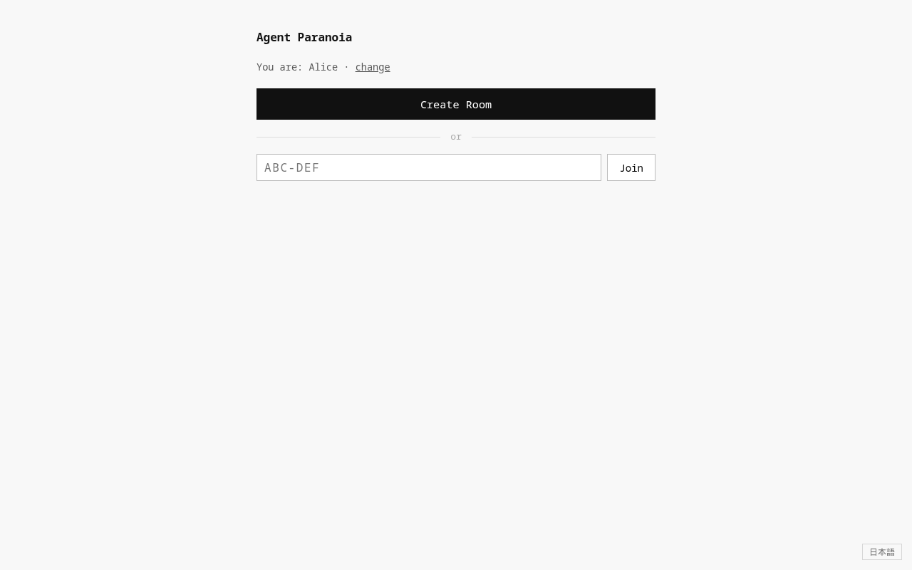
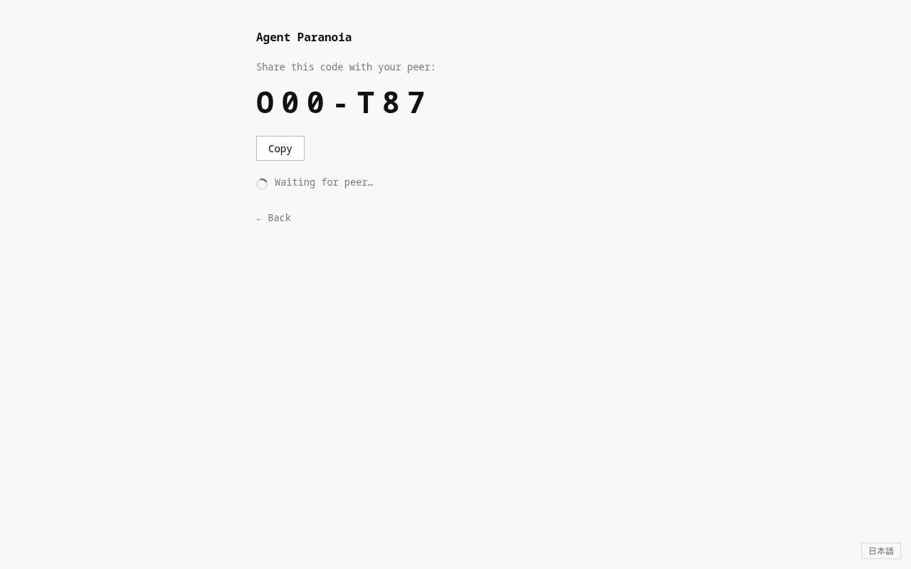
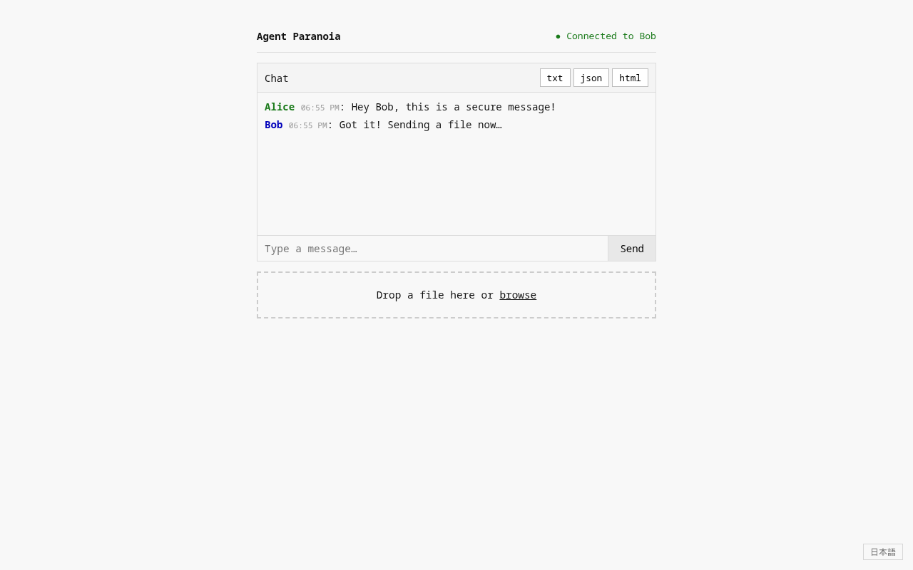

# Agent Paranoia

A self-hosted, browser-native P2P file transfer and chat app. Files and messages travel directly between peers over an encrypted WebRTC DataChannel — they never touch the server. No accounts, no installs, no stored data.

## Screenshots

| Home | Lobby | Session |
|------|-------|---------|
|  |  |  |

## Architecture

```
Browser ──── signaling (WebSocket) ──── Node.js server
   └──────── file/chat (WebRTC DataChannel, DTLS) ──────┘
```

The server only brokers the initial WebRTC handshake. Once connected, all traffic is peer-to-peer and end-to-end encrypted. The server never sees file contents or chat messages.

**Stack:** Vanilla JS · Node.js + Socket.io · Self-hosted STUN (Coturn)

## Threat model

**Protected against:**
- Server-side snooping — P2P DataChannel, server sees nothing
- Passive network surveillance — DTLS encryption on all WebRTC traffic
- Physical server compromise — no stored messages, files, or logs

**Not protected against:**
- A compromised browser on either end
- Signaling server downtime (transfers in progress are unaffected, new connections cannot be established)
- ICE candidates leaking your IP to your peer — inherent to WebRTC, use a TURN relay if this matters

## Prerequisites

- Node.js 18+
- A server or VPS with a public IP (or Headscale for a private WireGuard mesh)
- nginx + Let's Encrypt for TLS (production)
- Coturn in STUN-only mode (optional, replaces Google STUN)

## Running locally

```bash
cd server
npm install
node signaling.js
```

Open two tabs at `http://localhost:7654`. One creates a room, the other joins with the code.

## Production deployment

```bash
# On your server
git clone https://github.com/YOU/agent-paranoia
cd agent-paranoia/server
npm install
PORT=3000 pm2 start signaling.js --name agent-paranoia
```

Put nginx in front and terminate TLS there. Clients connect via `wss://`.

```nginx
server {
    listen 443 ssl;
    server_name yourdomain.com;

    ssl_certificate     /etc/letsencrypt/live/yourdomain.com/fullchain.pem;
    ssl_certificate_key /etc/letsencrypt/live/yourdomain.com/privkey.pem;

    location / {
        proxy_pass http://localhost:3000;
        proxy_http_version 1.1;
        proxy_set_header Upgrade $http_upgrade;
        proxy_set_header Connection "upgrade";
        proxy_set_header Host $host;
    }
}
```

## Switching to self-hosted STUN

Replace the ICE config in `client/src/webrtc.js`:

```javascript
const ICE_CONFIG = {
  iceServers: [{ urls: 'stun:YOUR_SERVER_IP:3478' }]
}
```

## Friend onboarding

Share your domain. They open it in any browser — no install required. One person creates a room, shares the 6-character code, the other joins.

## License

AGPL-3.0
