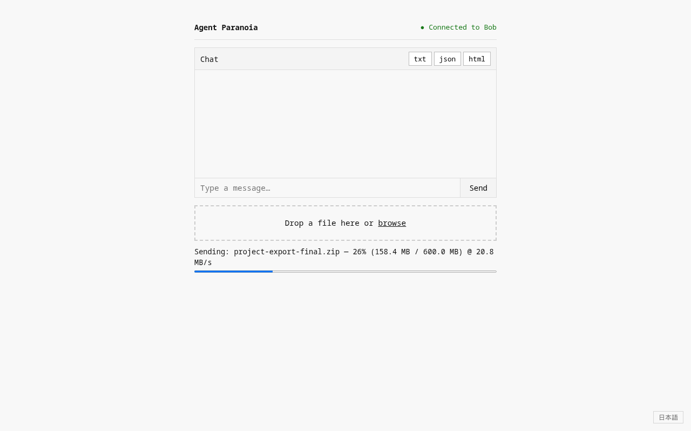

# Agent Paranoia

A self-hosted, browser-native P2P file transfer and chat app. Files and messages travel directly between peers over an encrypted WebRTC DataChannel — they never touch the server. No accounts, no installs, no stored data.

## Screenshots

| Home | Lobby | Session | File transfer |
|------|-------|---------|---------------|
|  |  |  |  |

## Architecture

```
Browser ──── signaling (WebSocket) ──── Node.js server
   └──────── file/chat (WebRTC DataChannel, DTLS) ──────┘
```

The server only brokers the initial WebRTC handshake. Once connected, all traffic is peer-to-peer and end-to-end encrypted. The server never sees file contents or chat messages.

**Stack:** Vanilla JS · Node.js + Socket.io · Self-hosted STUN (Coturn). No third-party services, CDNs or trackers: the page, Socket.io client and STUN all come from your own server.

## Threat model

**Protected against:**
- Server-side snooping — P2P DataChannel, server sees nothing
- Passive network surveillance — DTLS encryption on all WebRTC traffic
- Physical server compromise — no stored messages, files, or logs
- Unwanted files — each incoming file needs the receiver to click Accept; nothing is sent before that, and a peer can't send more than it announced
- Third parties learning who talks to whom — no Google STUN or other outside services

**Not protected against:**
- A compromised browser on either end
- A malicious operator of the signaling server — it relays the handshake and could in principle man-in-the-middle it (no fingerprint verification yet)
- Leaked room codes — a code works like a one-time password for its room; share it privately
- Signaling server downtime (transfers in progress are unaffected, new connections cannot be established)
- Your peer seeing your IP — inherent to WebRTC. On a Tailscale setup they see your tailnet (100.x) address, not your home IP

## Receiving files

Every incoming file shows an Accept / Decline prompt first.

- **With a download folder set** (Settings → Download folder, Chrome and Edge on desktop): files stream straight to disk as they arrive, so size is only limited by disk space. Existing files are never overwritten; a second `photo.jpg` becomes `photo (1).jpg`. The folder is remembered per browser; after a reload the browser may ask once to allow access again.
- **Without one** (or in Firefox / Safari): the file is held in the tab's memory until you click **[Save]**, which hands it to the browser's normal download location. Fine for everyday files; very large ones (multiple GB) can crash the tab, and closing the tab before saving loses the file. The prompt warns about this for large files.

## Running locally

```bash
cd server
npm ci
node signaling.js
```

Open two tabs at `http://localhost:7654`. One creates a room, the other joins with the code. With no `STUN_URLS` set, only peers on the same machine or network can connect, which is all you need for development.

## Deploying on a Tailscale tailnet (recommended)

The app and STUN are only reachable on your private tailnet, and calls run directly between devices over Tailscale. Nothing is exposed to the internet and no port forwarding is needed. Headscale works the same way.

You need: a Linux machine on your tailnet that stays on (examples call it `myhost`), Node.js 18+, and the friends you want to use it with invited to your tailnet.

**1. Get the code**

```bash
git clone https://github.com/atae/agent-paranoia.git ~/agent-paranoia
cd ~/agent-paranoia/server && npm ci
```

Cloning over HTTPS means the server can pull updates without a GitHub key. Update later with `git pull` and a service restart.

**2. Run coturn as a STUN-only server**

```bash
sudo apt install coturn
sudo mv /etc/turnserver.conf /etc/turnserver.conf.orig
sudo tee /etc/turnserver.conf >/dev/null <<'EOF'
listening-port=3478
stun-only
no-cli
no-tls
no-dtls
fingerprint
EOF
echo 'TURNSERVER_ENABLED=1' | sudo tee /etc/default/coturn
sudo systemctl enable --now coturn
ss -ulpn | grep 3478    # should show coturn listening
```

Why this matters: browsers hide local addresses (including your 100.x tailnet address) from WebRTC. Asking a STUN server *over the tailnet* is how each browser learns its tailnet address, so calls connect through Tailscale. A public STUN server (like Google's) reports public IPs instead, and two people on different networks usually can't connect that way.

**3. Run the app as a service**

Create `/etc/systemd/system/agent-paranoia.service` (adjust the user, paths and tailnet name):

```ini
[Unit]
Description=Agent Paranoia signaling server
After=network-online.target tailscaled.service
Wants=network-online.target

[Service]
User=youruser
WorkingDirectory=/home/youruser/agent-paranoia/server
ExecStart=/usr/bin/node signaling.js
Environment=NODE_ENV=production
Environment=STUN_URLS=stun:myhost.your-tailnet.ts.net:3478
Environment=HOST=127.0.0.1
Restart=on-failure

[Install]
WantedBy=multi-user.target
```

```bash
sudo systemctl daemon-reload
sudo systemctl enable --now agent-paranoia
curl -s localhost:7654/config.json    # should show your STUN address
```

- `STUN_URLS` takes a tailnet name or 100.x IP, comma-separated if more than one. If MagicDNS names don't resolve on some device, use the IP.
- `HOST=127.0.0.1` keeps the plain-HTTP port off your LAN; Tailscale Serve (next step) is the only way in.
- **Changing settings later:** after editing `Environment=` lines, always `sudo systemctl daemon-reload && sudo systemctl restart agent-paranoia`; a running server keeps the old values until restarted. If you use `systemctl edit` instead, type your lines at the top, above the "Lines below this comment will be discarded" marker; anything below it is thrown away.

**4. Put it on your tailnet with HTTPS**

```bash
sudo tailscale serve --bg 7654
```

This serves the app at `https://myhost.your-tailnet.ts.net` with a certificate from Tailscale. For a name that doesn't depend on the machine (e.g. `https://agent-paranoia.your-tailnet.ts.net`), define a Tailscale Service in the admin console and serve it from this machine instead; see Tailscale's Services docs.

**5. Allow the traffic in your tailnet policy**

Put the people who should use it in a group and grant three things: the web app, STUN on the server, and direct connections between their devices for the calls themselves:

```jsonc
"groups": {
  "group:ap": ["you@example.com", "friend1@example.com", "friend2@example.com"]
},
"grants": [
  // Open the app (use your Service name, or the server's tag/hostname)
  { "src": ["group:ap"], "dst": ["svc:agent-paranoia"], "ip": ["tcp:443"] },
  // STUN on the server
  { "src": ["group:ap"], "dst": ["tag:apps"], "ip": ["udp:3478"] },
  // Calls go straight between people's devices, on random UDP ports
  { "src": ["group:ap"], "dst": ["group:ap"], "ip": ["*"] }
]
```

Use the Admin console's **Access controls → Preview rules** to check what a given device can reach. Note: tagging a device removes its user identity, so grants for a user or group no longer cover it.

**6. Check it end to end**

On each person's browser, open the app and paste this into the DevTools console:

```js
const pc = new RTCPeerConnection(await (await fetch('/config.json')).json());
pc.createDataChannel('x');
pc.onicecandidate = e => e.candidate && console.log(e.candidate.candidate);
await pc.setLocalDescription(await pc.createOffer());
```

You want a line containing `typ srflx` with a **100.x** address. Then make a test call: the console should show `[ice] state: connected`.

## Troubleshooting

| Symptom | Likely cause | Fix |
|---|---|---|
| Join seems to do nothing, then "Couldn't connect to the other person" | No usable STUN, or the policy blocks peer-to-peer UDP | Run the check in step 6. No `srflx` line: coturn isn't running/reachable (UDP 3478). `srflx` is 100.x on both sides: allow `group:ap` → `group:ap` in step 5 |
| `srflx` shows a public IP, not 100.x | STUN is being reached outside Tailscale | Use the server's 100.x IP in `STUN_URLS` |
| Console shows `ICE servers: []` or the wrong server | `STUN_URLS` not set in the running process | `daemon-reload`, then restart the service; confirm with `curl localhost:7654/config.json` |
| "Room is full" | A third person already joined, or a very old server version | Create a new room; update and restart the server |
| Page won't load on one device | Tailscale stopped on that device, or MagicDNS off | Start Tailscale ("Run unattended" on Windows keeps it up); enable "Use Tailscale DNS" |

## Deploying on a public VPS

**Simplest: put the VPS on your tailnet** and follow the Tailscale steps above unchanged. The VPS only runs the app and STUN; calls still go directly between devices over Tailscale. The benefit is uptime: it doesn't depend on a home machine being on.

**Without Tailscale (open internet)**, more is needed:

- **TLS:** put nginx or Caddy with Let's Encrypt in front (sample below) and set `HOST=127.0.0.1`.
- **TURN relay:** with STUN alone, people behind strict NATs (mobile carriers, many offices and cafés) often can't connect directly. You'd run coturn as a TURN relay with credentials; relayed calls pass through (encrypted) and use the VPS's bandwidth. The app doesn't hand out TURN credentials yet.
- **Access control:** anyone on the internet can load the page and create rooms. Room codes are the only gate, so add rate limiting or a login before relying on this.
- **IP exposure:** peers see each other's public IPs instead of tailnet addresses.

```nginx
server {
    listen 443 ssl;
    server_name yourdomain.com;

    ssl_certificate     /etc/letsencrypt/live/yourdomain.com/fullchain.pem;
    ssl_certificate_key /etc/letsencrypt/live/yourdomain.com/privkey.pem;

    location / {
        proxy_pass http://127.0.0.1:7654;
        proxy_http_version 1.1;
        proxy_set_header Upgrade $http_upgrade;
        proxy_set_header Connection "upgrade";
        proxy_set_header Host $host;
    }
}
```

## Friend onboarding

1. Invite them to your tailnet (admin console → Users → Invite) and add them to `group:ap`.
2. They install Tailscale, sign in with the invited account, and open the app's `https://….ts.net` address in any browser.
3. Optional: Chrome or Edge users can pick a download folder under Settings for large files.

One person creates a room and shares the 6-character code; the other joins.

## License

AGPL-3.0
